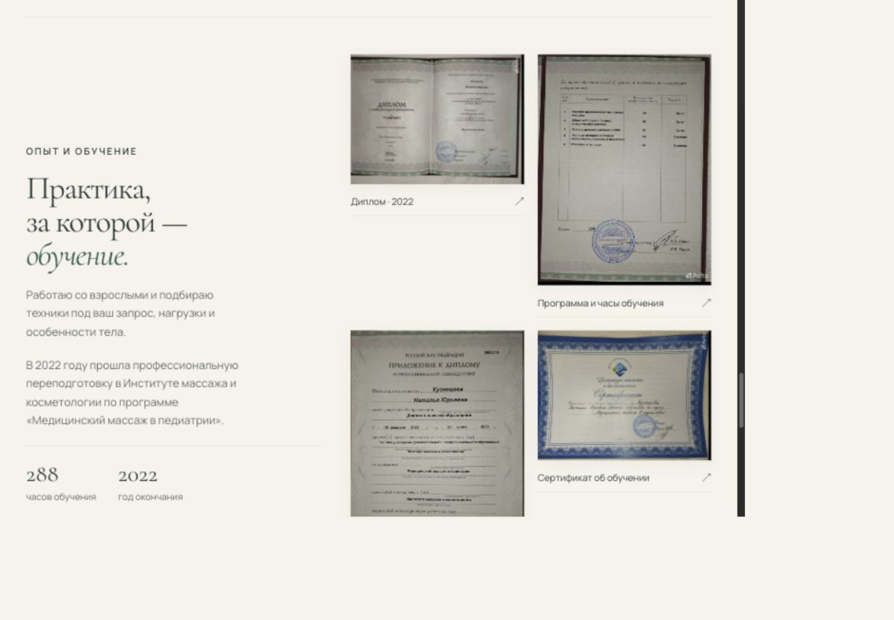
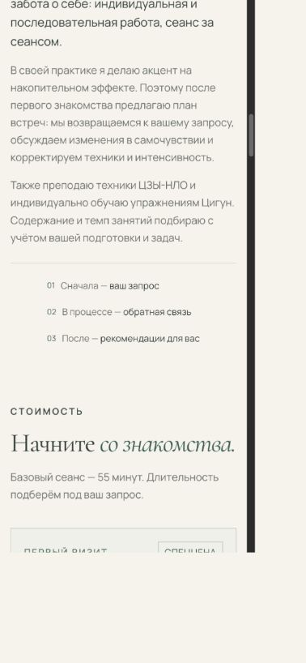

# Уточнения после второго этапа

Локальная версия, база `027402a`. GitHub/Vercel не обновлялись.

## Реализовано

- Группа шагов 01–03 центрирована по горизонтали, сохранив одну колонку и общую ось номеров.
- Между «55 минут.» и «Длительность» добавлен пробел, сохраняющийся при скрытии переноса строки.
- Абонемент: скидка 10% в карточке, FAQ и выборе записи вместо прежних 15%.
- Массаж лица: отдельная составляющая по запросу, с собственной кнопкой и контекстом в диалоге. Цена и длительность не выдуманы.
- Галерея: четыре уникальных документа из пяти ранее присланных изображений. Дубликат не добавлялся. Присланный рукописный сертификат относится к педиатрии; текст отдельно поясняет подтверждённую пользователем работу со взрослыми, без изменения названий документов.
- Подписи длительности под четырьмя видео убраны. Добавлен `controlslist="nodownload"`, подавление контекстного меню только над видео и убраны прямые ссылки MP4 из fallback-текста. Полной защиты от сохранения это не даёт, поддержка controlsList зависит от браузера.

## Проверки

Фактические CSS-ширины: 320, 390, 768, 1440. Горизонтального переполнения нет;
отклонение центра группы шагов от центра контейнера менее 0,01 CSS px.
Все четыре изображения документов загрузились (`complete` и `naturalWidth>0`).
Кнопки «Обсудить массаж лица» и «Узнать об абонементе» проверены в браузере:
отображаются контекст лица без вымышленной цены и скидка 10% соответственно.
Проверка источников подтвердила корректные ID, якоря, локальные ресурсы, неизменность
четырёх цитат отзывов, отсутствие 15% в публичном HTML/JS и подписей длительности роликов.
`node --check dist/app.js` и `git diff --check` — passed.
Нативная команда сохранения скрывается только там, где браузер учитывает controlsList;
сохранение через инструменты браузера/запись экрана не блокируется.

## Ожидают ответа пользователя

- Подпись вместо «Спеццена»: рекомендовано «Для знакомства»; варианты «Первое посещение» и «Ваша первая встреча». До выбора прежняя подпись сохранена.
- В первичном источнике учебного центра встречается «Цзин-ло»: https://centermassage.ru/meridiani . Тождественность практики Натальи не установлена, поэтому прежнее написание пока не изменено.
- Предложен плеер в стиле сайта: обложка, изумрудная кнопка запуска, пауза/звук, перемотка и спиннер загрузки. Этот вариант ещё не согласован и не реализован. Пока сохранён обычный плеер с ограничениями скачивания.

Документация поведения native controls: https://developer.mozilla.org/en-US/docs/Web/API/HTMLMediaElement/controlsList .
Эти изменения не запускают Tasks 3–5 прежнего плана целиком.

