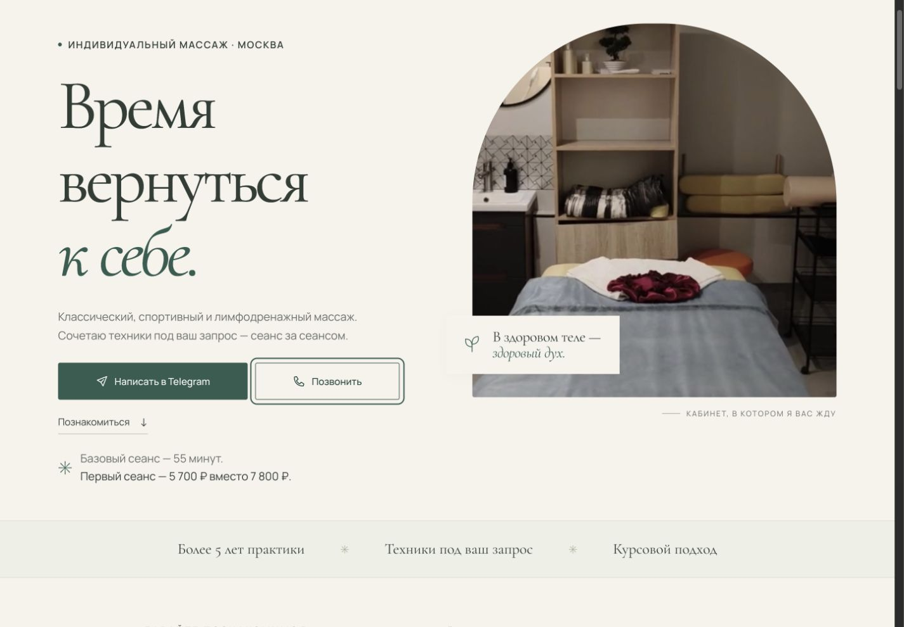
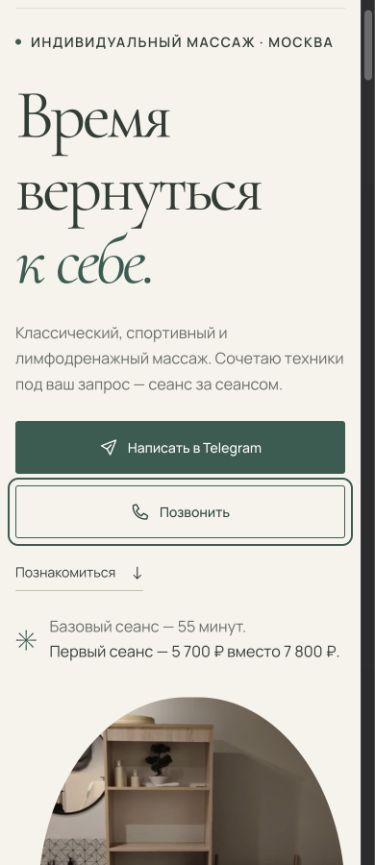

# Независимый QA прямой связи — 15 октября 2026

Объект: `/private/tmp/nk-massage-publish-20261015`, локальный diff после `a03d942`, URL http://127.0.0.1:4179/. Проверка проведена самостоятельно по исходникам и в Codex IAB (browser id 2), во временной вкладке 1. Отчёт исполнителя не использован как доказательство. Продуктовый код не менялся.

Вердикт: **проверено в указанном объёме, дефектов не найдено**. Это не разрешение на публикацию и не тест с реальными посетителями.

| Критерий | Результат | Доказательство |
|---|---|---|
| Статические локальные ресурсы | PASS | `python3 /Users/user/Developer/portfolio-nk/scripts/check_site.py --root /private/tmp/nk-massage-publish-20261015/dist`: exit 0, `OK: 1 HTML page(s), local links/CSS URLs and 2 JavaScript file(s) checked`. |
| Чистота diff | PASS | `git diff --check`: exit 0, без вывода. |
| Удалён обязательный выбор/диалог | PASS | Исходный HTML и DOM: 0 `dialog,[data-book]`. Чтение полного `app.js`: нет обработчиков записи, перехвата Telegram/tel, обработчик кликов навигации только закрывает меню. |
| Обычные ссылки и адреса | PASS | Python HTMLParser исходного HTML: 13 Telegram anchors, все `https://t.me/NataUsolar`, все с `noopener`; 3 телефонных anchors, все `tel:+79295373338`. DOM подтверждает те же href. Ни один внешний контакт не открывался. |
| Без JS: семантика исходника | PASS | Все контактные CTA присутствуют как настоящие `<a href>` в исходном HTML, без зависимости от JS для href. Это статическая проверка, не запуск браузера с отключённым JS. |
| Иконки/имена | PASS | DOM новых контактных CTA: SVG `aria-hidden=true`; исходник также `focusable=false`. Видимые тексты Telegram/Позвонить; телефон имеет полное aria-label, 6 ссылок практик имеют конкретные имена «Обсудить…». |
| Факты | PASS | DOM/AX: первый сеанс 5 700 ₽ вместо 7 800 ₽, 55 минут; массаж всего тела 5 700–7 800 ₽; абонемент 10%. |
| 320 px | PASS | Actual `innerWidth=320`, `documentElement.scrollWidth=305` (полоса прокрутки 15 px); hero CTA x=16…289, first visit x=37…268; текст CTA помещается. Визуально hero читаем. |
| 390 px | PASS | Actual `innerWidth=390`, scrollWidth=375. Hero/footer CTA x=16…359, first visit x=37…338; scrollWidth CTA равен clientWidth (341/299). Мобильный снимок ниже. |
| 768 px | PASS | Actual `innerWidth=768`, scrollWidth=753. Проверка границ всех `.contact-actions a,.session-select`: нет выхода за viewport или собственного переполнения. Визуальный просмотр выполнен. |
| 1440 px | PASS | Actual `innerWidth=1440`, scrollWidth=1425. Hero пара x=92.5…636.5, header Telegram x=1199.76…1332.5; все пары CTA без собственного переполнения. Desktop снимок ниже. |
| Клавиатурный фокус | PASS | Переход Tab из Telegram hero на телефон при 1440 и 390: activeElement — «Позвонить», outline `rgb(49,93,80) solid 2px`, offset 6px. Виден на снимках. |
| Мобильное меню/Escape | PASS | 390: «Открыть меню» → expanded true; Escape → expanded false, фокус возвращён `.menu-toggle`. Повторное открытие → «Стоимость» → hash `#prices`, expanded false. |
| Карусели | PASS | 1440: «Следующий отзыв» и «Следующий документ»: оба индикатора сменились с `1 из 4` на `2 из 4`. |
| Видео: без autoplay, play и взаимная пауза | PASS | На загрузке все 4 video: autoplay=false, paused=true. UI «Смотреть: Работа руками»: paused=false, readyState=4, currentTime=0.100299. Затем «Смотреть: Сеанс массажа»: первое paused=true/time=0.130985, второе paused=false/readyState=4/time=0.159406. |
| Консоль страницы | PASS | `tab.dev.logs({levels:[error,warn],limit:15})` вернул `[]`. Сам инструмент CUA печатал ошибки своей Statsig-телеметрии ab.chatgpt.com (Cloudflare 403); это не сообщения консоли локальной страницы. |
| Запуск Telegram/телефона, отправка | NOT RUN | По границе задачи контакты не открывались и сообщения не отправлялись. Проверены href и отсутствие JS-перехвата. |
| Реальный телефон, другие браузеры/ОС, полная видеоматрица, JS-disabled browser | NOT RUN | Проверена только адаптивная ширина IAB; это не эмуляция ОС телефона и не физическое устройство. Полная регрессия, dark footer focus/reduced-motion отдельно не расширялись по заданному объёму. |

В конце override viewport сброшен через `reset()`, временная вкладка закрыта. Zoom не менялся, основные вкладки не трогались. Единственная неуспешная вспомогательная попытка — клик паузы по предполагаемому имени, которого уже не было в текущем состоянии; страницу затем перезагрузили, это остановило видео перед мобильным снимком. Проверка play/mutual pause выше подтверждена отдельными DOM-состояниями.

