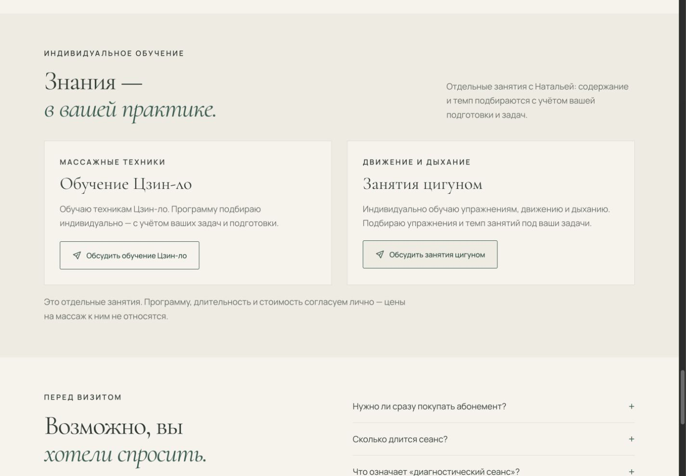
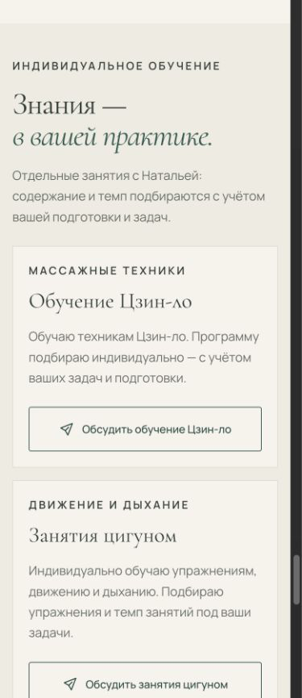
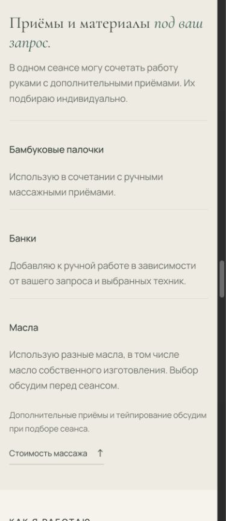

# Независимый QA: обучение и материалы — 15 октября 2026

Рабочая копия: `/private/tmp/nk-massage-publish-20261015`, основа `d0b4c9c`.
Объект: локальный `http://127.0.0.1:4179/`, HTTP Range сервер основного агента.
Проверял отдельный QA агент; изменены только этот отчёт и `screenshots/learning-*.png`.
Браузер: Codex In-app Browser, browser 2, временная вкладка 1. Проверка через viewport override, devicePixelRatio 1; это не испытание на реальном телефоне. Zoom не менялся.

## Результаты

| Критерий | Итог | Доказательство |
| --- | --- | --- |
| Статическая целостность | PASS | `python3 /Users/user/Developer/portfolio-nk/scripts/check_site.py --root /private/tmp/nk-massage-publish-20261015/dist` → `OK: 1 HTML page(s), local links/CSS URLs and 2 JavaScript file(s) checked`, exit 0. |
| Чистота diff | PASS | `git diff --check`, exit 0, без вывода. |
| Существующие якоря сохранены | PASS | Сравнение всех HTML id с `git show d0b4c9c:dist/index.html`: removed ids `[]`; добавлены `learning`, `learning-title`, `materials-title`. Все текущие внутренние href имеют цель. |
| Мобильное меню → обучение | PASS | 320 px: открыть меню, нажать «Обучение» → URL `/#learning`, меню закрыто, `aria-expanded=false`. После завершения плавной прокрутки верх learning 28.03 px. |
| Desktop меню → обучение | PASS | 1440 px: «Обучение» → `/#learning`, секция доступна. |
| Подход → обучение | PASS | 1440 px: «Подробнее об обучении» → `/#learning`; после завершения прокрутки верх learning 28.17 px. |
| Переполнение 320 / 390 / 768 / 1440 | PASS | Измеренные actual innerWidth: 320 / 390 / 768 / 1440; documentElement.scrollWidth: 305 / 375 / 753 / 1425. Разница 15 px соответствует полосе прокрутки, горизонтального overflow нет. |
| Адаптивная сетка | PASS | На 320 / 390 / 768 материалы и обучение — одна колонка (273 / 343 / 699.23 px). На 1440 материалы — 392×3, обучение — 604×2. |
| Читаемость новых заголовков/кнопок | PASS | Визуально 320 и 390: без обрезания; длинная кнопка на 320 переносит подпись и остаётся внутри карточки. На 1440 две карточки помещаются. Снимки ниже. |
| Клавиатурный фокус на светлом фоне | PASS | На 390 через Tab фокус перешёл на «Обсудить занятия цигуном»; видимое кольцо, computed outline `rgb(49, 93, 80) solid 2px`, offset 6 px. |
| Desktop шапка | PASS | 1440: wordmark x92.5–339.78, nav x685.12–1165.76, Telegram x1199.76–1332.5. Наезда нет, визуально меню одной строкой. |
| Содержание массажа и материалов | PASS | DOM и diff: четыре строки массажа; Цзин-ло остался массажным приёмом. Три карточки: палочки / банки / масла, включая собственное. Без новых цен и лечебных обещаний. |
| Отдельное обучение | PASS | После education и до FAQ; две карточки с самостоятельными подписанными Telegram ссылками. Явно сказано о личном согласовании программы, длительности и стоимости и о неприменимости цен массажа. |
| Цены и время | PASS | DOM и diff: 5 700 вместо 7 800 ₽, базово 55 минут, тело 5 700–7 800 ₽, абонемент 10%; эти блоки не изменены. |
| Контактные href | PASS | Все Telegram href `https://t.me/NataUsolar`, телефон `tel:+79295373338`. Проверено чтением href без внешнего перехода, сообщений и звонков. |
| Документы и отзывы | PASS | В DOM четыре ссылки документов и четыре отзыва. На 768 нажаты «Следующий документ» и «Следующий отзыв»; оба счётчика изменились с 1 из 4 на 2 из 4, предыдущие кнопки активировались. |
| Видео без автозапуска | PASS | Четыре video в DOM, у всех `paused=true`, `autoplay=false` до взаимодействия. JS и видеоблок в diff не изменены. |
| Глубокая регрессия плеера / FAQ / zoom / reduced motion | NOT RUN | Вне согласованного лёгкого прогона этой контентной доработки. |
| Реальные мобильные браузеры / внешние приложения | NOT RUN | Проверена только ширина viewport в IAB; Telegram и телефон не открывались. |

## Снимки

## Вердикт и ограничения

В согласованном объёме проверено; воспроизведённых дефектов не найдено. Это экспертный браузерный прогон, не тестирование на клиентах. Плавная прокрутка проверена после достижения конечной позиции: немедленный снимок после клика может показывать промежуточный участок страницы. Снимки получены JPEG API браузера и сохранены как PNG без изменения содержимого.

Временный viewport сброшен, временная вкладка закрыта. Исходный сервер и чужие вкладки не затронуты. Push, публикация, PR и внешние коммуникации не выполнялись. Отчёт не является разрешением на публикацию.
