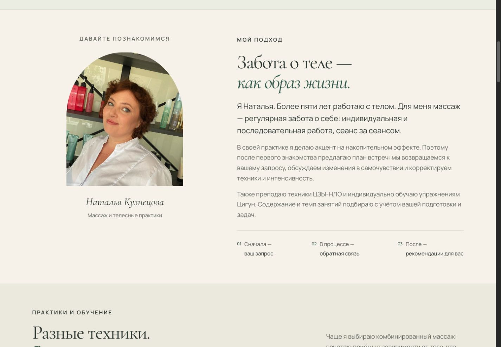
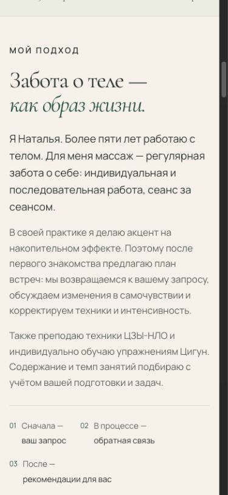
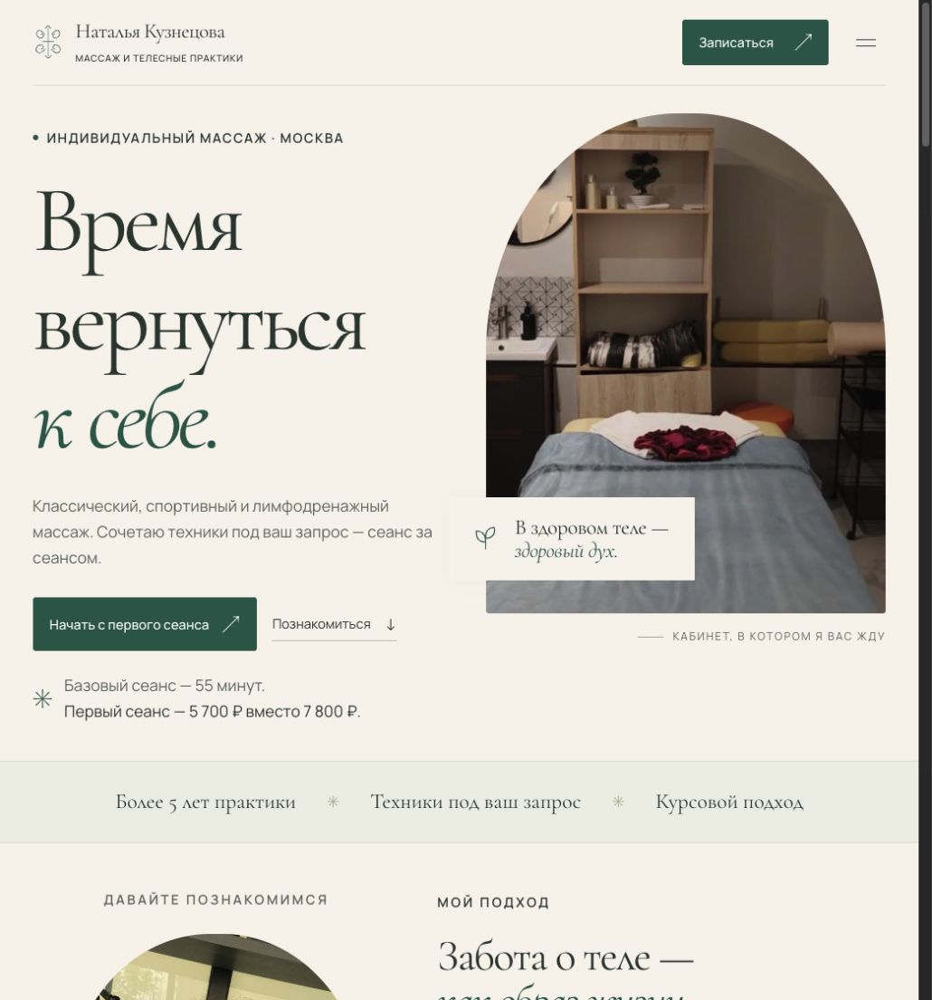
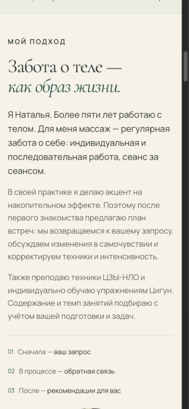

# Первый этап: адаптивная типографика и отступы

15 октября 2026 года. Репозиторий `aestepanova/NK_massage`, ветка
`codex/responsive-typography`, база `a63a801`. Проверка локального статического
предпросмотра на `http://127.0.0.1:4179/` в браузере Codex IAB.
Изменения не отправлены на GitHub и не опубликованы на Vercel.

## Изменения и сравнение

Vanilla JS, палитра, шрифты, изображения, тексты и порядок секций сохранены.
HTML меняет версию stylesheet в URL для обновления кеша и убирает принудительные переносы внутри трёх шагов. CSS развёрнут
в читаемый формат; затронутые размеры используют общие переменные и относительные
единицы. Пиксельные значения сохранены для границ, медиа и части старых правил,
не требующих механического перевода.

| Измерение на 1440 CSS px | Было | Стало |
| --- | --- | --- |
| Абзацы `.approach-copy > .body-copy` | 13 px | 18 px |
| Текст `.approach-principles p` | 10 px | 15,4 px |
| Вертикальный отступ `.section` | 110 px | 72 px |
| H1 line-height | 0,92 | 1,05 |

Размеры в таблицах — результаты измерения браузером, не фиксированные настройки CSS.
Основная шкала — `clamp(1rem, .95rem + .25vw, 1.125rem)`, лид — от `1.125rem`,
вторичный текст — от `.875rem`, корневой размер — `100%`. Основной интервал секций —
`clamp(2.75rem, 5vw, 4.75rem)`; на 390 он равен 44 px вместо прежних 64 px.
Из-за увеличения текста общая длина страницы не обязана уменьшиться.

## Проверенные экраны

| Viewport | Основной абзац | Отступ секции | Горизонтальная прокрутка страницы / карточки цены |
| --- | --- | --- | --- |
| 320 × 740 | 16 px | 44 px | нет / нет |
| 390 × 844 | 16,175 px | 44 px | нет / нет |
| 768 × 1024 | 17,12 px | 44 px | нет / нет |
| 1280 × 600 | 18 px | 64 px | нет / нет |
| 1440 × 1000 | 18 px | 72 px | нет / нет |

Проверены вычисленные размеры и `scrollWidth <= clientWidth` корня/карточки.
На 320 первый экран и карточка цены просмотрены визуально: H1 помещается,
«Диагностический» читается целым словом, отметка «Спеццена» переносится целиком.
На 390 просмотрен блок подхода; на 1440 — знакомство, подход, выделение H1/контактов.
На промежуточной ширине 1130 при удвоенном корневом тексте переполнения не было.

## Взаимодействия и выделение

- Меню открывается на 390; переход к «Мой подход» закрывает его и меняет якорь.
- Окно записи открывается на 320, остаётся в ширине экрана и прокручивается;
  Escape закрывает его и возвращает фокус к кнопке «Записаться на знакомство».
- Выделение текста на desktop имеет фон `#d7ddc5` и тёмные буквы `#203c32`.
  H1 и нижний контактный заголовок при выделении читаются без обрезки букв.
- Клавиатурный переход к телефону в тёмном блоке даёт видимый светлый outline
  `rgb(247, 243, 236) solid 2px`.
- Текущие сообщения консоли: ошибок и предупреждений не получено.

## Масштабирование: что проверено, что нет

Текст 200% проверен временной копией страницы с `html { font-size: 200% }`:
320, 390, 768, 1130 и 1440 CSS px. Горизонтального переполнения страницы не было;
окно записи на 390 прокручивалось, управляющие элементы оставались доступны.
Временная страница удалена и в коммит не входит. Это проверка удвоенного корневого
шрифта, а не эмуляция всех пользовательских настроек браузера.

Настоящий page zoom 200% не подтверждён: Cmd+= в IAB не изменило viewport/DPR.
Подмена `transform: scale()` или CSS zoom за проверку браузерного масштаба не выдаётся.
Реальные iOS/Android и браузерное увеличение страницы остаются ручной проверкой.

## Статические проверки и ревью

- `node --check dist/app.js` — passed; JavaScript не изменён.
- `git diff --check` — passed.
- Локальные ссылки ресурсов: 22, пропущенных файлов — 0; битых якорей — 0;
  повторяющихся ID — 0; H1 — один.
- Независимое техническое ревью: 0 Critical, 1 Important, 0 Minor.
  Important исправлен: поздние групповые правила больше не возвращают текст
  секций к 12/13 px. Повторная проверка `.section-heading > p`, `.visit-intro > .body-copy`
  и `.visit-steps p` дала 18 px на desktop.

## Снимки

Desktop, 1440 × 1000:

Mobile, 390 × 844:

## Граница этапа

Задачи 2–5 из плана не выполнялись: порядок блоков, путь записи, обучение и
продвижение требуют следующего согласованного этапа. PR, push и deployment не выполнялись.

## Уточнения после просмотра пользователем

Слоган «В здоровом теле — здоровый дух» на промежуточной ширине оказался ниже
фотографии: Grid растягивал `.hero-visual` до высоты соседнего текста, а абсолютная
плашка считала `bottom` от этого увеличенного контейнера. До исправления на 871 CSS px
низ фотографии был 609,1 px, верх плашки — 651,4 px: пересечения не было.
`height: fit-content` возвращает контейнеру высоту его фотографии и подписи.

По просьбе пользователя три принципа теперь всегда расположены одной колонкой,
без принудительных переносов между началом фразы и выделенной частью.
Проверены 320, 390, 768, 1045 и 1440 CSS px: плашка пересекает фотографию,
у всех трёх шагов общий левый край и последовательные непересекающиеся строки;
горизонтального переполнения страницы нет. Проверка `git diff --check` — passed.

