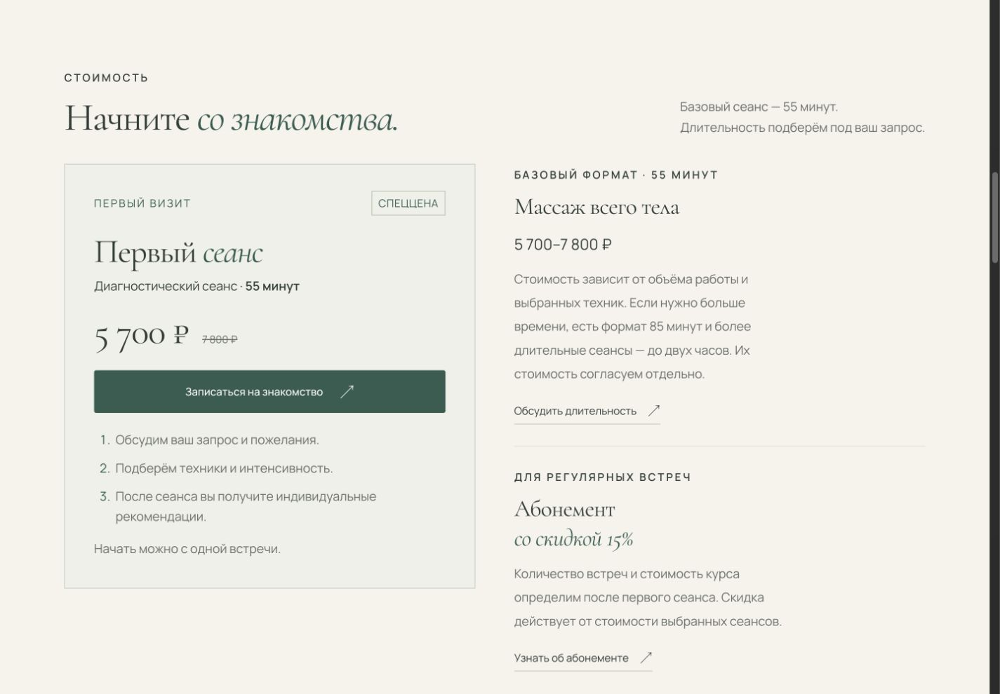
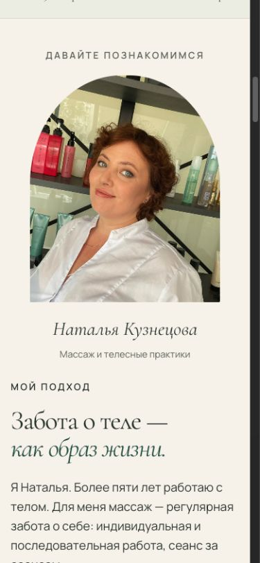
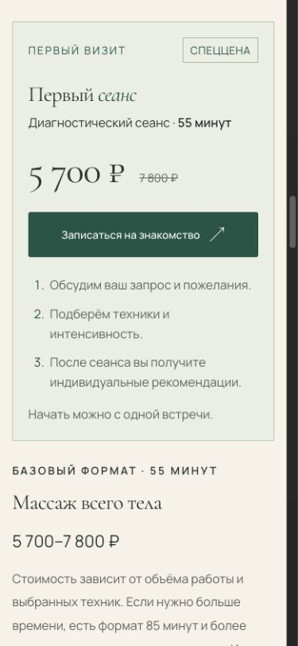

# Этап 2: знакомство и первый визит

15 октября 2026 года. Репозиторий `aestepanova/NK_massage`, локальная ветка
`codex/responsive-typography`, база этапа `922e72b`. Предпросмотр: `http://127.0.0.1:4179/`.
Push, PR и deployment не выполнялись. Публичный сайт этой итерацией не обновлялся.

## Что изменилось

Порядок: первый экран → знакомство и подход → стоимость/первый визит → практики →
видео → отзывы → образование → FAQ → контакты. На телефоне сначала видны фото,
имя и подпись Натальи, потом длинный текст о подходе. DOM-порядок совпадает с визуальным.

Карточка «Первый сеанс» объединяет 55 минут, 5 700 ₽ вместо 7 800 ₽, кнопку записи,
три коротких шага и возможность начать с одной встречи. Старая самостоятельная секция
первой встречи удалена, `#first-visit` перенесён на карточку, `#visit-title` сохранён.
Карточка не растягивается до высоты соседнего столбца. Ссылка из практик к стоимости
теперь отмечена стрелкой вверх, в соответствии с новым положением блока.

Отзывы стоят перед образованием. Добавлен H2 «Отзывы клиентов», первым идёт отзыв
Лены Лопаткиной. Все четыре цитаты, имена и контекст KUSHETKA сохранены дословно.

## Проверки в браузере Codex

| Проверка | Результат |
| --- | --- |
| 320×740, 390×844, 768×1024, 1280×600, 1440×1000 | Корень и карточка цены без горизонтального переполнения |
| 320 и 390 | Портрет и подпись полностью предшествуют тексту подхода |
| Текст 200%, корневой шрифт 32 px: 320, 390, 768, 1440 | Корень и карточка без переполнения; все три шага остаются в документе |
| Мобильное меню → «Стоимость» | Меню закрывается, переход к `#prices` |
| Кнопка нового первого визита | Диалог показывает 55 минут и 5 700 ₽ вместо 7 800 ₽ |
| Escape из диалога | Закрывает окно и возвращает фокус к исходной кнопке |
| Карусель вперёд | 1 → 2 → 3 → 4; крайняя кнопка отключается |
| Карусель назад и ArrowLeft/ArrowRight | Счётчик и текущий отзыв меняются корректно |
| Документы после перехода к образованию | Оба изображения `complete=true`, `naturalWidth=540` |
| Прежние восемь секционных якорей | Существуют, имеют ненулевую высоту; все прежние ID сохранены |
| Видео | Четыре исходных элемента без autoplay, JS управления не изменён |
| Консоль | Ошибок и предупреждений не получено |

До реализации браузерные предикаты `pricesBeforeSessions`, `firstVisitInsidePrices`,
`reviewsBeforeEducation`, `portraitBeforeCopy` на 390 были ложными; после — истинными.
Структурная проверка также сравнила исходные цитаты с базой, проверила уникальные ID,
старые якоря, локальные ресурсы и неизменность JavaScript. Результат — PASS.
`node --check dist/app.js` и `git diff --check` — passed.

Проверка текста 200% использовала временную HTML-копию с удвоенным корневым шрифтом;
она удалена и в публикуемый каталог не входит. Настоящий browser page zoom 200% и
реальные iOS/Android остаются непроверенными. Экспертное ревью не заменяет проверку
конверсии на реальных посетителях.

## Независимое ревью

Один технический проход по этапу 2: 0 Critical, 0 Important, 0 оставшихся Minor.
Замечание о направлении стрелки к стоимости исправлено и повторно проверено.
Контекст отзывов, цены, порядок якорей, перемещение портрета и отсутствие новых
JS-зависимостей проверены ревьюером по фактическому diff.

## Снимки

Стоимость на компьютере:

Портрет до текста на телефоне:

Первый визит на телефоне:

## Осталось за границами этапа

Tasks 3–5 не выполнялись: прямые основные ссылки Telegram, разделение обучения и
продвижение остаются будущими этапами. Основание сравнения обычной и специальной
цены уточняется у Натальи; суммы сохранены. Публикация требует отдельного разрешения.
